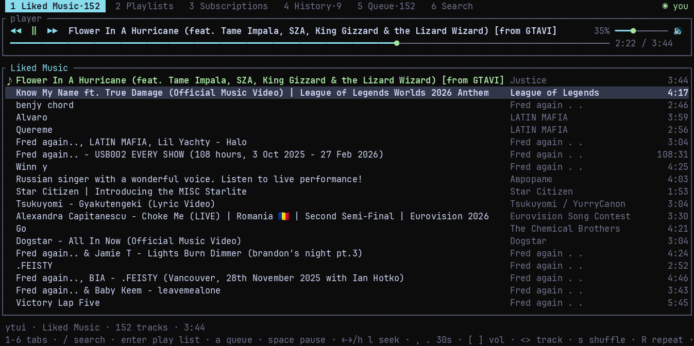

# ytui

> [!WARNING]
> **This project is 100% AI-generated.** Every line of code, the documentation
> and the commit messages were written by an AI model, not by a human. It has
> not been audited or security-reviewed. ytui handles YouTube cookies that carry
> your account session, so read the code before trusting it with your
> credentials and use it at your own risk. There is no warranty; see
> [LICENSE](LICENSE).

A terminal player for YouTube Music. Audio only: no browser, no video window.

```
┌─ 1 Liked Music·412 ─ 2 Playlists ─ 3 Subscriptions ─ 4 History ─ 5 Queue·2 ─ 6 Search·30 ─ ◉ you ┐
├─ player ─────────────────────────────────────────────────────────────────────────────────────────┤
│ ◀◀  ‖  ▶▶  Bullet For My Valentine - Tears Don't Fall                      ⤨  100% ━━━━━━━━━● 🔊 │
│ ━━━━━━━━━━━━━━━●────────────────────────────────────────────────────── 1:23 / 6:45  Bullet…      │
├─ Liked Music ────────────────────────────────────────────────────────────────────────────────────┤
│ ▶ Song A                                                              Artist · 3:45              │
│   Song B                                                              Artist · 4:01              │
└──────────────────────────────────────────────────────────────────────────────────────────────────┘
 1-6 tabs · / search · enter play list · a queue · space pause · ←→/h l seek · , . 30s · [ ] vol …
```



Your Liked Music, playlists, subscriptions, history and search in six tabs,
with keyboard and mouse control. The OS media keys work too, even while the
terminal is in the background. Press `?` in the player for the full key list.

## 1. Install

**Linux, WSL or macOS:**

```bash
git clone https://github.com/tacamihail/ytui.git
cd ytui
./install.sh
ytui doctor
```

The script downloads the release binary for your platform and adds `yt-dlp`,
`deno` and the ALSA runtime when they are missing; a fork, an unreleased
commit or an unsupported platform falls back to building from source (add
`--from-source` to force that). It is safe to rerun, and `ytui doctor`
verifies the setup.

**Windows** — the player runs natively, no WSL needed. In PowerShell:

```powershell
git clone https://github.com/tacamihail/ytui.git
cd ytui
.\install.ps1
ytui doctor
```

From cmd.exe, run `install.cmd` instead; if PowerShell refuses to run
`install.ps1`, use `powershell -ExecutionPolicy Bypass -File .\install.ps1`.
Open a new terminal afterwards so the updated `PATH` is picked up. A release
install needs neither Rust nor a linker; a source build
(`.\install.ps1 -FromSource`) needs the MSVC linker ("Visual Studio Build
Tools" with the "Desktop development with C++" workload). Windows Terminal is
recommended over legacy `conhost` for the box drawing and mouse support.

To update later: `ytui update`, or press `u` in the player.

Manual builds, the macOS app bundle, WSL audio and how to uninstall:
[docs/install.md](docs/install.md). How a release is published:
[docs/releases.md](docs/releases.md).

## 2. Sign in with cookies (optional)

Search and playback work without an account. Your Liked Music, playlists and
subscriptions need YouTube cookies — there is no OAuth app and no API key.

```bash
ytui auth ~/cookies.txt      # import a cookies.txt export
ytui auth --browser chrome   # or read them from a local browser
ytui auth --status           # check what is connected right now
ytui logout                  # forget the cookies and the account
```

How to export cookies that keep working:

1. Install the "Get cookies.txt LOCALLY" extension in Chrome or Firefox and
   allow it in private windows.
2. Open a **new private/incognito window** and sign in to
   <https://music.youtube.com>.
3. In that same tab, open <https://www.youtube.com/robots.txt>.
4. Export the `youtube.com` cookies to `cookies.txt`.
5. **Close the private window** and never reopen it.

The export must include the HttpOnly cookies (the extension adds them).
`ytui auth` verifies the file with YouTube and refuses a signed-out export
rather than overwriting a working setup. Use one export per machine: two
copies of the same session rotate independently and Google signs both out.

Why the private window matters, and reading cookies straight from a browser:
[docs/account.md](docs/account.md).

## 3. Use a resolver on another machine (optional)

Resolving a track briefly runs `yt-dlp` and deno: about 110 MB plus a 300 MB
peak, once per track. `ytui-resolver` is a small server for another box (a
NAS, a Raspberry Pi, a VPS on your tailnet), so the spike happens there and
only the resolved URL crosses the network.

On the server (needs Rust 1.89+, `yt-dlp` and `deno`):

```bash
cargo install --git https://github.com/tacamihail/ytui ytui-resolver
ytui-resolver --bind 0.0.0.0:8787 --allow-private   # trusted LAN or tailnet
```

On the player:

```bash
ytui discover --save
```

The installers also scan for a resolver automatically on a fresh install.
Leave the server anonymous (no `--cookies`) unless you need age-restricted or
members-only tracks: two machines sharing one session sign each other out,
and the player falls back to its own yt-dlp when the server can't help.

Run at login, tokens, public addresses, automatic updates:
[docs/resolver.md](docs/resolver.md).

## Using it

`1`-`6` or `Tab` switch tabs, `Enter` plays, `space` pauses, `/` searches and
`?` lists every key. The mouse works too: click rows, tabs, the progress bar
and the player buttons. Tabs, keys and media keys:
[docs/usage.md](docs/usage.md) · settings and files:
[docs/config.md](docs/config.md).

## Problems?

Run `ytui doctor` first. The full list with explanations is in
[docs/troubleshooting.md](docs/troubleshooting.md).

## Documentation

- [docs/install.md](docs/install.md) — what the installers do, manual builds,
  macOS and WSL notes, uninstall
- [docs/account.md](docs/account.md) — cookies: the export, session rotation,
  one export per machine
- [docs/resolver.md](docs/resolver.md) — the remote resolver
- [docs/usage.md](docs/usage.md) — tabs, keys, mouse, media keys
- [docs/config.md](docs/config.md) — the config table and files on disk
- [docs/audio.md](docs/audio.md) — how the audio pipeline works
- [docs/memory.md](docs/memory.md) — measured RAM numbers
- [docs/troubleshooting.md](docs/troubleshooting.md) — the full problem list
- [docs/releases.md](docs/releases.md) — how a release is tagged and published

## License

MIT. The full text is in [LICENSE](LICENSE).
