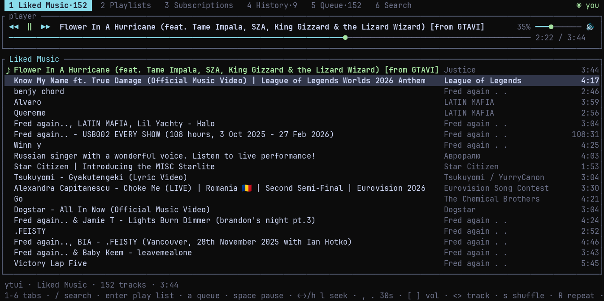

# ytui

> [!WARNING]
> **This project is 100% AI-generated.** Every line of code, the documentation
> and the commit messages were written by an AI model, not by a human. It has
> not been audited or security-reviewed. ytui handles YouTube cookies that carry
> your account session, so read the code before trusting it with your
> credentials and use it at your own risk. There is no warranty; see
> [LICENSE](LICENSE).

A terminal player for YouTube Music. Audio only: no browser and no video
window.

ytui asks yt-dlp for the stream URL, then pulls the AAC file over HTTP Range,
decodes it with `symphonia` and writes to `cpal` (ALSA on Linux, CoreAudio on
macOS, WASAPI on Windows). yt-dlp exits after resolving, so nothing else is
running while you listen.

```
┌─ 1 Liked Music·412 ─ 2 Playlists ─ 3 Subscriptions ─ 4 History ─ 5 Queue·2 ─ 6 Search·30 ─ ◉ you ┐
├─ player ─────────────────────────────────────────────────────────────────────────────────────────┤
│ ◀◀  ‖  ▶▶  Bullet For My Valentine - Tears Don't Fall                      ⤨  100% ━━━━━━━━━● 🔊 │
│ ━━━━━━━━━━━━━━━●────────────────────────────────────────────────────── 1:23 / 6:45  Bullet…      │
├─ Liked Music ────────────────────────────────────────────────────────────────────────────────────┤
│ ▶ Song A                                                              Artist · 3:45              │
│   Song B                                                              Artist · 4:01              │
└──────────────────────────────────────────────────────────────────────────────────────────────────┘
 1-6 tabs · / search · enter play list · a queue · space pause · ←→/h l seek · , . 30s · [ ] vol …
```



## Audio

ytui only downloads an audio stream, so the video resolution on YouTube does
not matter. It asks for AAC (`itag` 141, then 140, then 139) and probes each
URL with a 1 KiB request, because YouTube sometimes returns 403 for one of
them.

The output stream is opened at the track's own sample rate. YouTube AAC is
44.1 kHz, so on a 44.1 kHz device nothing is resampled. If the device refuses
that rate, ytui falls back to 48 kHz and resamples. Windows WASAPI shared mode
only accepts the device mix format, which is usually 48 kHz, so there the
44.1 kHz tracks are resampled by default.

On Windows the player also follows the system default output device, checked
every two seconds: connecting Bluetooth headphones mid-song reopens the stream
on them and carries the unplayed seconds over, instead of leaving the music on
the speakers the stream was opened on.

Working out a stream URL takes `yt-dlp` about four seconds, which used to be
dead air between songs. The next track is resolved in the last ten seconds of
the current one and only its URL is kept (a few hundred bytes, no audio), so
the handover costs about 0.2 s without holding links for songs that are still
far away. A resolve that hangs is killed after 30 seconds, and a failed one is
retried once: otherwise a transient error would leave the next track to be
resolved at the handover, which is heard as a three-second pause.

The audio is pulled in 256 KiB HTTP ranges by a background thread that keeps
about a minute of encoded sound ready ahead of the decoder. The decoded ring is
only two seconds, so earlier a range request that stalled for a few seconds was
an audible hole in the middle of a track; now the music plays on while the
request catches up. The ranges reuse one keep-alive connection instead of
opening a new TLS session every sixteen seconds.

Opus (`itag` 251) would be a bit better than 128 kbps AAC, but `symphonia` has
no Opus decoder, so those uploads are skipped with a message.

## Quick start

### 1. Install the player

Linux, WSL and macOS use the same commands:

```bash
git clone https://github.com/tacamihail/ytui.git
cd ytui
./install.sh
```

`install.sh` installs a current Rust (via rustup when the system one is too
old), `yt-dlp`, `deno` and the ALSA headers when needed, then builds and
installs `~/.local/bin/ytui`. Verify it:

```bash
ytui doctor
```

Windows runs the player natively, without WSL, so resolver discovery can see
the LAN and audio goes through WASAPI. In PowerShell:

```powershell
git clone https://github.com/tacamihail/ytui.git
cd ytui
.\install.ps1
```

From cmd.exe, run `install.cmd` instead; it calls the same script with a
process-local execution policy. If PowerShell refuses to run `install.ps1`,
that wrapper (or `powershell -ExecutionPolicy Bypass -File .\install.ps1`) is
the way around it. The script installs Rust via rustup when
needed, downloads `yt-dlp.exe` and Deno, builds the release binary and copies
`ytui.exe` to `%USERPROFILE%\.local\bin`, adding that directory to the user
`PATH`. Open a new terminal afterwards and run:

```powershell
ytui doctor
```

The build needs the MSVC linker: install "Visual Studio Build Tools" with the
"Desktop development with C++" workload if you do not have Visual Studio.
Windows Terminal is recommended over legacy `conhost` for the box drawing and
mouse support.

### 2. Connect your YouTube account (optional)

Liked Music, playlists and subscriptions need cookies; search and playback do
not. Export `cookies.txt` from a private window as described in
[Account](#account), then import and check it:

```bash
ytui auth ~/cookies.txt
ytui auth --status
```

Or let yt-dlp read a local browser profile:

```bash
ytui auth --browser chrome
```

`ytui logout` forgets the cookies and the saved account.

### 3. Install ytui-resolver on another machine (optional)

The resolver moves yt-dlp/deno's memory spike off the player machine. It is a
separate package: no TUI, no audio crates, no ALSA. On the server:

```bash
# Option A: build only the resolver (needs Rust 1.89+)
cargo install --git https://github.com/tacamihail/ytui ytui-resolver

# Option B: no checkout; also installs yt-dlp and deno
curl -fsSLO https://raw.githubusercontent.com/tacamihail/ytui/main/install-resolver.sh
bash install-resolver.sh --from-git
```

Both options need `yt-dlp` and `deno` on the server. The script installs them;
`cargo install` does not.

Update it later with `ytui-resolver update` (or `update --check` to only ask
github); it rebuilds in place and restarts the autostart entry.

Launch it on a trusted LAN or tailnet without a token:

```bash
ytui-resolver --bind 0.0.0.0:8787 --allow-private
```

Leave `--cookies` off unless you need age-restricted or members-only tracks.
The resolver never receives the player's cookies, but if you give it a copy of
the same session, two machines keep their own `cookies.txt` and refresh
`__Secure-1PSIDTS` independently; when they drift, Google can treat the second
one as a stolen session and sign the account out. Age-restricted tracks still
play when the server is anonymous: the client falls back to its own yt-dlp when
the server answers `502`. `ytui doctor` prints a line when the resolver reports
that it uses cookies.

For a public address, generate a token and run the same bind **without**
`--allow-private`:

```bash
ytui-resolver --gen-token
ytui-resolver --bind 0.0.0.0:8787
```

Add `--install-service` to run it at login instead, reusing the same options:

```bash
ytui-resolver --bind 0.0.0.0:8787 --allow-private --install-service
```

That writes a systemd user unit on Linux, a LaunchAgent on macOS and a Startup
entry on Windows. `--uninstall-service` removes it. See
[Run at login](docs/resolver.md#run-at-login).

On the player machine, discover a tokenless private resolver and save it:

```bash
ytui discover --save
```

If the resolver is not on the local network (Tailscale, WireGuard, a VPN,
another subnet, or a client inside WSL), pass its address instead:

```bash
ytui discover --url http://100.64.0.5:8787 --save
```

Or open the player and press `?`, then `s`, to scan the local network again. A
public resolver is not found by the scan: set `resolver_url` and
`resolver_token_file` in `~/.config/ytui/config.json` (see
[Client config](#client-config)).
`ytui doctor` prints the resolver address, version and latency. More detail:
[Remote resolver](#remote-resolver).

## Install details

The installer is safe to rerun. It keeps an existing config and updates the
binary in place. On Linux the build needs a C linker and the ALSA headers
(`libasound2-dev`, `alsa-lib` or `alsa-lib-devel`); the script installs them
when it can, and prints the package names when it cannot. On macOS it checks
for the Xcode command line tools and installs the deno build for your
architecture.

On Windows, `install.ps1` also downloads the standalone `yt-dlp.exe`, so no
Python is needed, and Deno is unpacked into `%USERPROFILE%\.deno\bin`. It
writes the checkout path to `%USERPROFILE%\.config\ytui\source`, so
`ytui update` rebuilds from the same place.

When no resolver is configured, the installer also scans the local network for
up to 10 seconds and saves a tokenless one if it finds it. Set
`YTUI_SKIP_DISCOVER=1` (or pass `-SkipDiscover` on Windows) to skip that scan.

To update later:

```bash
ytui update          # pull and rebuild when a newer version is published
ytui update --check  # only report whether one exists
```

The version is the `[package] version` in `Cargo.toml`; commits that do not
change it are not installed. `ytui update` refuses to touch a checkout with
uncommitted changes or local commits. It updates the checkout the installer ran
from; set `YTUI_SRC` to point elsewhere. Inside the player, `?` checks github
and `u` installs a newer version; a clickable `↑ 0.4.0` chip appears when one
is waiting.

Manual build:

```bash
cargo build --release
mkdir -p ~/.local/bin
cp target/release/ytui ~/.local/bin/ytui
```

On Windows the same manual build is:

```powershell
cargo build --release
New-Item -ItemType Directory -Force -Path "$env:USERPROFILE\.local\bin"
Copy-Item target\release\ytui.exe "$env:USERPROFILE\.local\bin\"
```

### WSL

WSL cannot discover a resolver on your LAN: it only sees the WSL virtual
network. Run the player natively on Windows (see above) if you want discovery,
or point it at the resolver explicitly with
`ytui discover --url http://<host>:8787 --save`.

WSL has no sound card, only a PulseAudio socket. ALSA's `default` device still
points at card 0, so ytui asks for the `pulse` PCM first and only falls back to
`default` when that fails. You just need the bridge:

```bash
sudo apt-get install -y libasound2-plugins
```

No `~/.asoundrc` edit is needed. `ytui doctor` prints the PCM it picked, for
example `✔ audio output: pulse @ 44100 Hz stereo`.

If you can't use sudo, `install.sh` extracts the package into `~/.local/alsa`
when apt fails and points the launcher at it with a private ALSA config. Your
`~/.asoundrc` is not touched. The manual equivalent is:

```bash
cd /tmp
apt-get download libasound2-plugins
dpkg -x libasound2-plugins_*.deb ~/.local/alsa
```

Then rerun `./install.sh` so it writes `~/.config/ytui/asound.conf` for the
launcher.

## Account

Liked Music, playlists and subscriptions need cookies from a browser that is
signed in to YouTube. There is no OAuth app and no API key: YouTube disabled
OAuth for yt-dlp, so cookies are the only way in.

```bash
ytui auth ~/cookies.txt      # import a Netscape cookies.txt
ytui auth --browser chrome   # or read them from a local browser
ytui auth --status           # what is connected right now
ytui logout                  # forget the cookies and the account
```

### Exporting cookies that keep working

YouTube rotates the account cookies on every open YouTube tab, as a security
measure. An export taken from a normal browser window goes stale within hours
or days, and exporting again from that same window keeps it stale. The fix is
to export from a session that is never opened again:

1. install "Get cookies.txt LOCALLY" and allow it in private windows
   (`chrome://extensions` → Details → *Allow in Incognito*)
2. open a **new private/incognito window** and sign in to
   <https://music.youtube.com>
3. in that same tab, open <https://www.youtube.com/robots.txt>; keep it the
   only private tab
4. export the `youtube.com` cookies to `cookies.txt`
5. **close the private window** and never reopen it

Nothing rotates that session after step 5, so the file keeps working for weeks
or months instead of expiring. This is the same advice as the "Exporting
YouTube cookies" section of the yt-dlp wiki.

ytui also serializes its own yt-dlp runs around the `--cookies` file. yt-dlp
saves the jar when it exits, which is how the rotating `__Secure-1PSIDTS`
stays current. A listing, a background prefetch and a manual resolve used to be
able to write the same jar at once; the last save could put a stale token back,
and the next request would sign the account out. The runs now share a
`cookies.txt.lock` file next to it, across the player, `ytui doctor` and
`ytui auth`. A second machine with its own copy of the same session cannot
share that lock — see the resolver note below.

The export has to include the HttpOnly cookies: without them the file is
signed out, and `ytui auth` refuses it rather than overwriting a working
`~/.config/ytui/cookies.txt`. `ytui auth` checks the cookies against YouTube,
saves the channel in `~/.config/ytui/account.json` and copies them to
`~/.config/ytui/cookies.txt` with mode `600`.

### Reading cookies from the browser

`ytui auth --browser <name>` skips the export: yt-dlp reads the browser's
cookie database on every run, so there is nothing in a file to go stale. Two
limits:

- on Linux, Chrome-family browsers encrypt their cookies with the system
  keyring. It works only if the keyring is unlocked and yt-dlp can decrypt
  them, otherwise `ytui auth` reports that it could not verify the account.
- subscriptions still need a file, because ytui parses that page itself.
  `--browser` alone leaves tab 3 empty.

Search and playback work without an account.

## Tabs

1. Liked Music (opens here)
2. Playlists
3. Subscriptions
4. History
5. Queue
6. Search

`Enter` on a playlist opens it, `Esc` goes back. History is local
(`~/.local/share/ytui/history.json`); Queue is whatever is playing now.

Liked Music, Playlists and Subscriptions are also cached in
`~/.config/ytui/cache/`, so switching to a tab paints the last list
immediately. A cache older than 15 minutes is refreshed in the background while
the old rows stay on screen; `r` refreshes right away. On a cold start,
`--lazy-playlist` streams the first page as yt-dlp reads it, so rows fill in
progressively instead of all appearing at once.

## Keys

`1`-`6`, `Tab` and `Shift+Tab` switch tabs. `Up`/`Down` or `j`/`k` move the
selection, `PageUp`/`PageDown` jump, `Enter` plays the list from the selected
row, `a` appends to the queue, `/` searches (a query, video URL or playlist
URL) and `r` refreshes.

`space` or `p` pauses, `left`/`right` seek 5 seconds, `,` and `.` seek 30,
`[` `]` change the volume, `m` mutes, `s` shuffles, `R` cycles repeat, `<` `>`
skip tracks, `x` stops, `d` deletes an entry, `c` copies the link, `?` shows
the help (with the version and an update check), `u` installs a newer version
(or checks when there is none), and `q` quits. Inside the help overlay, `s`
scans the local network for a resolver (see [Remote resolver](#remote-resolver)).

The mouse works as well: click a tab, click a row to select it, double-click
to play, click the progress bar to seek, and click the buttons in the player.
The wheel moves five rows at a time. The speaker at the end of the player line
mutes, and the slider to its left can be clicked or dragged.

The row that is playing is marked with a green ▶ in every list that contains
it, so it is easy to find your place after browsing elsewhere.

When a track can't be resolved because YouTube no longer serves it, ytui says
so in the status line and moves to the next one. It gives up after five dead
tracks in a row, which usually means the problem is cookies or the network
rather than the list; `space` retries.

## Config

`~/.config/ytui/config.json` (on Windows
`%USERPROFILE%\.config\ytui\config.json`) is created on the first run or by
the installer:

| field | default | meaning |
|---|---|---|
| `cookies_file` | `""` | cookie file path, set by `ytui auth` |
| `cookies_browser` | `""` | read cookies from a browser instead |
| `results_count` | `30` | search results |
| `fetch_limit` | `2000` | max entries per playlist or feed |
| `history_limit` | `300` | history entries kept |
| `seek_step` | `5.0` | seconds for `left`/`right` |
| `volume_step` | `5` | percent per `[` `]` |
| `volume` | `35` | starting volume |
| `buffer_ms` | `2000` | audio ring buffer |
| `cache_kib` | `256` | HTTP Range chunk size |
| `resolver_url` | `""` | remote resolver base URL; empty = resolve locally |
| `resolver_token` | `""` | bearer token (prefer the file) |
| `resolver_token_file` | `""` | token file; empty = `~/.config/ytui/resolver.token` when it exists |
| `resolver_timeout_secs` | `20` | how long to wait for the resolver |
| `resolver_fallback` | `true` | use local yt-dlp when the resolver fails |

## Remote resolver

Resolving a track starts `yt-dlp`, which starts deno to solve YouTube's JS
challenge: about 110 MB plus a 300 MB peak for a few seconds, once per track.
If that spike is unwelcome on the machine that plays music, run the small
`ytui-resolver` binary on another box (a NAS, a Raspberry Pi, a tailnet VPS).
The client then asks it for stream candidates and keeps audio playback and
the 1 KiB probes local.

### Install on the server

The resolver is a separate package. Building it does not compile the TUI,
`ratatui`, `cpal` or `symphonia`, and the server needs no ALSA. The resulting
binary is about 600 KB.

If the server has Rust 1.89+, this downloads the source to cargo's cache and
builds only `ytui-resolver` and `ytui-resolve`:

```bash
cargo install --git https://github.com/tacamihail/ytui ytui-resolver
```

The binary lands in `~/.cargo/bin/ytui-resolver`. `cargo install` does not
install `yt-dlp` or `deno`; the server still needs both.

If you prefer a checkout, or want the script to install `yt-dlp` and `deno`
too:

```bash
git clone https://github.com/tacamihail/ytui.git
cd ytui
./install-resolver.sh          # add --token for public/token mode
```

`install-resolver.sh` builds only `-p ytui-resolver` and installs
`~/.local/bin/ytui-resolver`. It upgrades an old system Rust via rustup. The
manual equivalent inside a checkout is:

```bash
cargo build --release -p ytui-resolver
install -Dm755 target/release/ytui-resolver ~/.local/bin/ytui-resolver
```

Without keeping a checkout, fetch the script and run it with `--from-git`:

```bash
curl -fsSLO https://raw.githubusercontent.com/tacamihail/ytui/main/install-resolver.sh
bash install-resolver.sh --from-git
```

### Launch

On a trusted LAN or tailnet, no token is needed:

```bash
ytui-resolver --bind 0.0.0.0:8787 --allow-private
```

Public addresses need a token:

```bash
ytui-resolver --gen-token
ytui-resolver --bind 0.0.0.0:8787
```

### Automatic discovery

When the installer runs and `resolver_url` is still empty, the client scans
localhost and the private networks for up to 10 seconds. If a tokenless
resolver answers on port 8787, its URL is saved to `config.json` and ytui uses
it from then on. If nothing answers, the config is left alone and ytui keeps
resolving locally with its own yt-dlp.

The same scan is in the help overlay: press `?`, then `s`. It may take up to
60 seconds (the install-time scan is capped at 10), and `ENTER` picks a listed
resolver while `ESC` cancels. From a shell:

```bash
ytui discover --save --timeout 10
```

The scan checks localhost and each private IPv4 `/24` the machine is attached
to, so it finds a resolver on a plain LAN without any extra tooling. It only
probes port 8787, and it never overwrites a `resolver_url` that is already
configured. When several tokenless resolvers answer, ytui picks the one with
the lowest estimated wait per track: the server's own recent resolve time from
`/v1/health` plus the health round-trip. The scan keeps probing for 1.5 s after
the first answer, so a neighbouring faster resolver still gets a chance.

Overlay networks are not a local `/24`, so the scan cannot see them: that
covers Tailscale's `100.64.0.0/10`, WireGuard and other VPNs, a resolver on
another subnet, and a client inside WSL (which only sees the WSL virtual
network). Point ytui at the address once instead:

```bash
ytui discover --url http://100.64.0.5:8787 --save
```

### Tokenless LAN or tailnet

Start the server with `--allow-private` to trust peers in private ranges
without a token. That covers RFC1918, link-local, IPv6 ULA and Tailscale's
`100.64.0.0/10` range:

```bash
ytui-resolver --bind 0.0.0.0:8787 --allow-private
```

Public peers still need a token, and are refused when no token is configured.
Without `--allow-private`, a non-loopback bind still refuses to start without
a token, as before.

### Public address with a token

For a resolver on a public address, keep the token requirement and configure
the same token on the client:

```bash
ytui-resolver --bind 0.0.0.0:8787 --token-file ~/.config/ytui/resolver.token
```

The server has no TLS of its own, so put Caddy or nginx in front when the
address is public. The automatic scan only finds private resolvers; a public
resolver is added by editing the config and is never overwritten by the
installer or a later scan.

### Client config

```json
"resolver_url": "http://100.64.0.5:8787",
"resolver_token_file": "",
"resolver_timeout_secs": 20,
"resolver_fallback": true
```

`YTUI_RESOLVER` and `YTUI_RESOLVER_TOKEN` override the URL and token.
`ytui doctor` prints the resolver version and latency. With
`resolver_fallback` on, a dead server falls back to local yt-dlp and shows
one toast per session; with it off, playback fails with the resolver error.

Only stream resolution moves. Search and playlists still use the local
`yt-dlp`, and subscriptions keep their existing API path, so the client keeps
its own yt-dlp and cookies.

There is deliberately no TLS in the server: run it on a LAN or a
Tailscale/WireGuard network, or put Caddy in front. The server learns which
videos you resolve, so treat it like the YouTube account it uses. See
[docs/resolver.md](docs/resolver.md) for the protocol, systemd unit and
cache/rate-limit details.

## Files

- `~/.config/ytui/config.json` - config
- `~/.config/ytui/cookies.txt` - imported cookies, mode `600`
- `~/.config/ytui/account.json` - channel name and id
- `~/.config/ytui/cache/` - last listing per tab, ignored after logout
- `~/.config/ytui/resolver.token` - token for the remote resolver, mode `600`
- `~/.local/share/ytui/history.json` - play history

On Windows the same layout lives under `%USERPROFILE%`: the config and cookies
are in `%USERPROFILE%\.config\ytui\`, history in
`%USERPROFILE%\.local\share\ytui\`, and the binary is
`%USERPROFILE%\.local\bin\ytui.exe`.

## Memory

Measured with a release build on WSL2 in a 130x30 terminal. The numbers are
`VmRSS` from `/proc/<pid>/status`, after the list finished loading:

| state | RSS |
|---|---|
| idle, Liked Music loaded | ~8 MB |
| playing a normal track | ~11.5 MB |
| playing a 108 h, 6.3 GB mix | ~16.5 MB |
| the same after seeking to the middle | ~16.5 MB |

Peak memory (VmHWM) was at most 1.5 MB above RSS.

The 108 h case is the largest because it keeps the file's fragment index in
RAM (about 0.6 MB, 39k fragments) so seeking stays a single request. Apart from
that index, memory is a roughly 1 MB audio ring, up to six 256 KiB range chunks
(four queued ahead of the decoder and two in flight, about 1.5 MB), the packet
being decoded and up to 16 resolved URLs (about 25 KiB).

Only the next track's URL is resolved, and only once the current one has about
ten seconds left. Resolving runs at `nice 10`, so it does not compete with the
decoder. A track you choose yourself is resolved immediately and never waits
behind that queue. On a machine where audio still crackles during playback,
`YTUI_PREFETCH=0 ytui` disables background resolution.

These are ytui's own numbers. Resolving a track also runs `yt-dlp`, which
starts deno to solve YouTube's JavaScript challenge: about 110 MB plus 300 MB
for two or three seconds, once per track. That is the spike a system monitor
shows when a track is resolved, and it belongs to those processes, not to the
player. Skipping to the track that is already being resolved waits for that
resolution instead of starting a second one.

The [remote resolver](#remote-resolver) exists for that spike: with
`resolver_url` set, those processes run on the server instead and the player
numbers in the table do not change.

The virtual size is bigger still (about 350 MB) because PulseAudio maps a few
64 MB shared-memory pools and glibc reserves heap for each thread. Almost none
of that is resident, so RSS is the number to watch.

`python3 tools/ram.py [URL ...]` runs the real TUI in a pty and prints the same
table on your machine, plus the peak of the resolver processes.

## Problems

No sound on WSL: `libasound2-plugins` is missing. Rerun `./install.sh` or run
`sudo apt-get install -y libasound2-plugins`; no `~/.asoundrc` is needed. If
`ytui doctor` says it cannot reach PulseAudio, check WSLg (`wsl --update` on
Windows) and that `PULSE_SERVER` points at `/mnt/wslg/PulseServer`.
On a desktop, check that PipeWire or PulseAudio is running.

A long title on the selected row scrolls to show the rest. It stops while the
terminal is in the background, which needs focus reporting: terminals that do
not implement it never report a lost focus, so the title simply keeps
scrolling. Under tmux or screen, enable it with `set -g focus-events on`.

"no AAC stream for this track (opus only)": the upload has no M4A audio and
`symphonia` can't decode Opus.

"unavailable on youtube": the upload was removed, is blocked in your country,
or is otherwise not served to this account. Nothing in ytui can fix it; the
track stays in the list until you unlike it on YouTube.

"private: sign-in required": the cookies expired. Export them again.

"playlist not found" on Liked Music or Watch Later: the export is signed out or
incomplete. Netscape exports need the HttpOnly cookies too ("Get cookies.txt
LOCALLY" includes them), so export while <https://music.youtube.com> is open in
a signed-in browser and run `ytui auth <file>` again. `ytui doctor` and
`ytui auth --status` check the cookies against YouTube.

Search returns nothing or a 403: `yt-dlp` is too old.

"Unable to extract uploader id": `yt-dlp` can't find `deno`. Make sure
`~/.deno/bin` (Windows: `%USERPROFILE%\.deno\bin`) is on `PATH`.

"resolver unavailable (...), using local yt-dlp": the configured resolver
did not answer and the client fell back. `ytui doctor` shows the reason.

"resolver: bad token": the client and server tokens differ. Regenerate with
`ytui-resolver --gen-token` and point `resolver_token_file` at the result.

Mouse does nothing: the terminal has to forward mouse events. Windows Terminal
and most Linux terminals do; in tmux add `set -g mouse on` and restart ytui.

Windows:

- `ytui` is not recognized after installing: the installer added
  `%USERPROFILE%\.local\bin` to the user `PATH`, which only new terminals pick
  up. Open a new Windows Terminal or PowerShell window, or run the full path
  `%USERPROFILE%\.local\bin\ytui.exe`.
- No sound: `ytui doctor` prints the WASAPI device and sample rate it opened.
  Check Settings → System → Sound that the intended output is the default.
  ytui moves to a new default while it is running; a build older than 0.4.7
  needs a restart after switching. WASAPI shared mode plays at the device mix
  rate, usually 48 kHz, so 44.1 kHz tracks are resampled.
- Garbled box drawing or no mouse: use Windows Terminal instead of legacy
  `conhost`.
- `ytui update` cannot replace `ytui.exe`: close the player first. The updater
  renames the running binary, but antivirus can briefly hold the file open.

Tracks that sound muffled only had 48 kbps HE-AAC (`itag 139`). Symphonia
decodes the AAC core but not the SBR band, so the highs are missing. ytui
prefers AAC-LC when YouTube offers it.

## Uninstall

```bash
rm ~/.local/bin/ytui ~/.local/bin/ytui.bin
rm -rf ~/.config/ytui ~/.local/share/ytui
```

On Windows:

```powershell
Remove-Item "$env:USERPROFILE\.local\bin\ytui.exe"
Remove-Item -Recurse -Force "$env:USERPROFILE\.config\ytui", "$env:USERPROFILE\.local\share\ytui"
```

## License

MIT. The full text is in [LICENSE](LICENSE).
